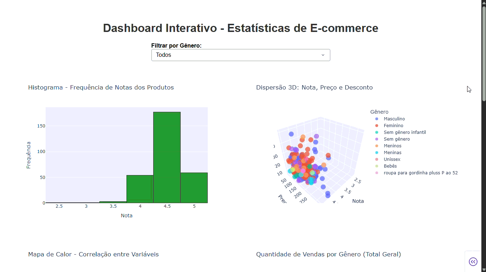

# Dashboard Interativo - Estatísticas de E-commerce

Aluno: Gabriel Siqueira dos Santos

Aplicação web desenvolvida em Python com **Dash** e **Plotly Express** para visualização interativa de métricas de vendas, avaliações, descontos e sazonalidade de produtos de e-commerce.
Atividade proposta pelo curso de formação em Analista de Dados pela Escola Britânica de Arte Criativas e Tecnologia (EBAC).

# Preview do Dashboard

# Visualizações Incluídas
* **Histograma:** Distribuição de frequência das notas dos produtos.
* **Dispersão 3D:** Relação tridimensional entre Nota, Preço e Desconto por gênero.
* **Mapa de Calor:** Matriz de correlação entre variáveis numéricas.
* **Gráfico de Barras Horizontais:** Volume total de vendas por gênero.
* **Gráfico de Pizza:** Participação percentual dos produtos por temporada.
* **Gráfico de Violino (Densidade):** Distribuição e quartis dos descontos aplicados.
* **Regressão Linear (OLS):** Tendência entre Preço e Desconto.
